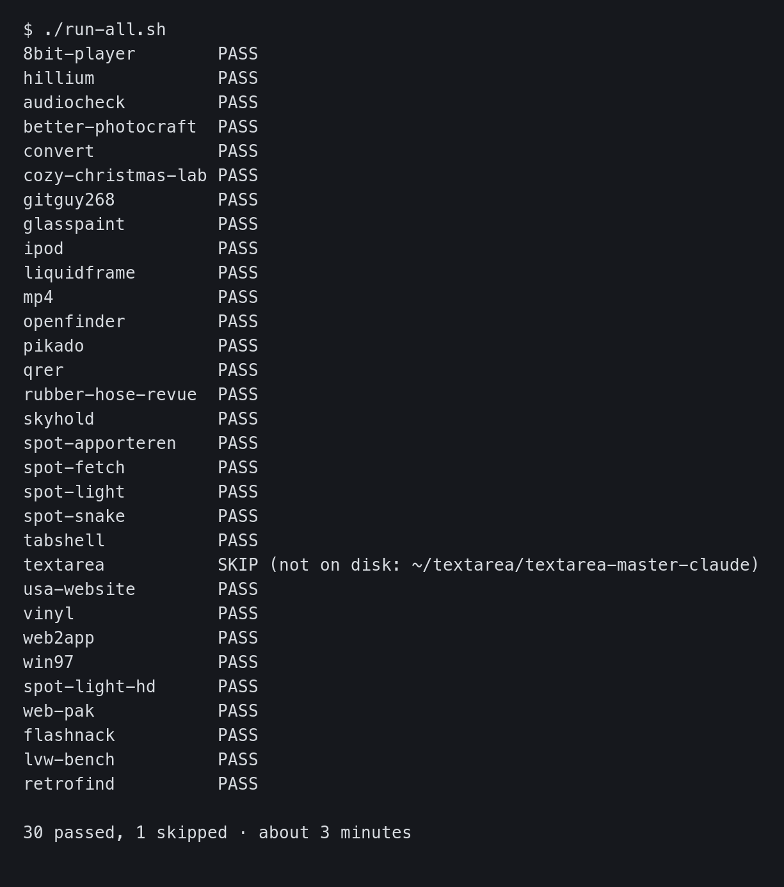

<div align="center">

# e2e-suite

**Browser smoke tests for 31 of my web apps, built on [tester-army/e2e](https://github.com/tester-army/e2e) with locators only and no AI model. One command runs them all.**

[What it tests](#what-it-tests) · [Run it locally](#run-it-locally-step-by-step) · [How it works](#how-it-works) · [Findings](FINDINGS.md) · [Limits](#limits)




</div>

Each test serves an app's existing build on a free port, opens it in headless Chromium, checks the title or a key element, does one real interaction, checks that it changed something, and fails on any uncaught JavaScript error. The last full run, its notes per app and what changed are in [FINDINGS.md](FINDINGS.md).

<!-- live-links -->
**Project page:** [gitguy268.github.io/e2e-suite](https://gitguy268.github.io/e2e-suite/) · [e2e-suite.vercel.app](https://e2e-suite.vercel.app)
<!-- /live-links -->

<!-- run-steps:start -->
## Run it locally, step by step

1. **Install [Node.js](https://nodejs.org) 22** or newer, and Python 3 (several apps are served with `python3 -m http.server`).

2. **Get the code:**

   ```sh
   git clone https://github.com/Gitguy268/e2e-suite.git
   cd e2e-suite
   ```

3. **Keep the apps next to each other,** with this folder and the apps in the same parent folder as listed in `apps.ts`, and build each app first. Set `E2E_PROJECTS_DIR` if they live somewhere other than your home folder. Apps that aren't there are skipped.

4. **Install the dependencies:**

   ```sh
   npm ci
   npx playwright install chromium
   ```

5. **Run everything, or name apps:**

   ```sh
   ./run-all.sh
   ./run-all.sh qrer spot-light
   APP=qrer npx e2e run --headed    # watch one
   ```

   Results go to `.e2e/results.txt`, with a log and a trace per app in `.e2e/`.
<!-- run-steps:end -->

## What it tests

| App | Served as | The test |
|---|---|---|
| 8bit-player | static folder | starts the player |
| audiocheck | its Vite build | checks a file |
| better-photocraft | static `dist/web` | boots past the loading screen |
| [convert](https://github.com/Gitguy268/convert) | its Vite build | loads its formats |
| cozy-christmas-lab | static folder | pauses |
| [flashnack](https://github.com/Gitguy268/flashnack) | its Vite build | loads the sample photos |
| [gitguy268](https://github.com/Gitguy268/Gitguy268.github.io) | static folder | the portfolio boots into the website view |
| glasspaint | static `_site` | opens the File menu |
| [hillium](https://github.com/Gitguy268/hillium) | static `site` | the landing page renders |
| ipod | static export `out/` | the menu renders |
| liquidframe | its Python server, on a throwaway library | the library loads |
| [lvw-bench](https://github.com/Gitguy268/LvW-bench) | static `web/` | the leaderboard switches track |
| mp4 | static folder | the composition renders |
| openfinder | its own Node server | opens the Sandbox, then Documents |
| pikado | its Vite build | creates a document |
| [qrer](https://github.com/Gitguy268/qrer) | its Python server | encodes a link |
| [retrofind](https://github.com/Gitguy268/retrofind) | its Python server, with no SearXNG behind it | takes a query (never searches) |
| rubber-hose-revue | static folder | opens the game |
| [skyhold](https://github.com/Gitguy268/skyhold) | its Go binary, file keyring, wiped each run | sets up and shows the cloud key |
| spot-apporteren | static folder | Spot sits |
| [spot-fetch](https://github.com/Gitguy268/spot-fetch) | its Vite build, **GPU** | turns on sound |
| [spot-light](https://github.com/Gitguy268/spot-light) | static folder | starts Dodge |
| [spot-light-hd](https://github.com/Gitguy268/spot-light-hd) | static folder, **GPU** | starts Lure in the living room |
| [spot-snake](https://github.com/Gitguy268/spot-snake) | static folder | starts |
| [tabshell](https://github.com/Gitguy268/tabshell) | its Node server | boots the VM |
| [textarea](https://github.com/Gitguy268/textarea) | its test server | takes a note (skipped while its folder is gone) |
| usa-website | static folder | searches cities |
| vinyl | static single-file build | turns the motor on |
| [web-pak](https://github.com/Gitguy268/web-pak) | static `app/` | opens and generates a password |
| [web2app](https://github.com/Gitguy268/web2app) | its Node server | fills the URL field (never builds) |
| win97 | its Vite build | opens Paint |

## How it works

<details>
<summary><b>One config, many apps</b></summary>

e2e runs every test against every target in a config, so the apps can't share one target list. `e2e.config.ts` builds a config for the single app named in `$APP`, and `run-all.sh` calls it once per app. The serve commands are in `apps.ts`, all on port 0, so the runner picks a free port. `errors.js` is injected into every page and collects uncaught errors in `window.__errs`; `tests/_noErrors.ts` asserts that list is empty.

</details>

<details>
<summary><b>The real GPU for WebGL apps</b></summary>

Headless Chromium draws WebGL in software, at about 1.5 s a frame for spot-fetch. e2e's `web()` engine has no option for browser launch flags, but it accepts a browser provider. `gpu-provider.ts` starts Playwright's Chromium with `--use-angle=metal` and hands e2e its DevTools endpoint, so the apps in `GPU_APPS` (spot-fetch, spot-light-hd) render at full speed.

</details>

<details>
<summary><b>Skipping what isn't there</b></summary>

`apps.ts` records the folder each app needs in `needs`. `run-all.sh` checks it before starting the app and prints `SKIP (not on disk: …)` instead of a failure, so the suite still runs after a project folder has been moved off the disk.

</details>

## Limits

- It tests the builds already on disk, not the source: rebuild an app before trusting a pass.
- Smoke depth only, one interaction per app. The apps' own test suites go deeper.
- It needs the apps on this machine, so CI can't run it; the GitHub workflow only publishes the project page.
- Native apps (videoina, container, superfile, pakket) and apps that only do something with a model engine (LvW-harness, usb-llms) aren't covered.

## Licence

MIT, see [LICENSE](LICENSE).
